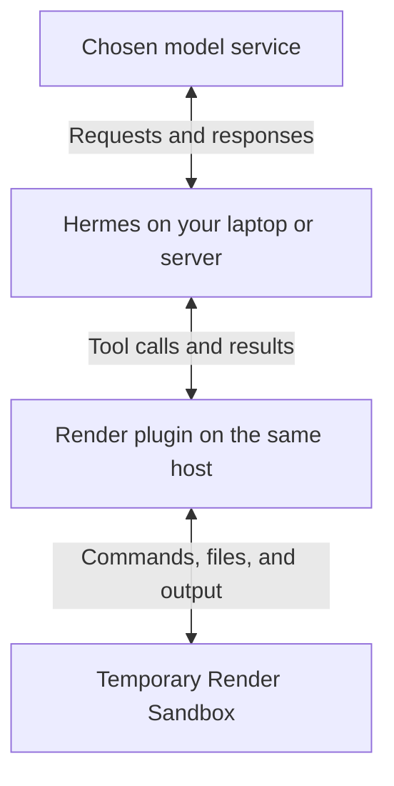

<div align="center">

# Hermes + Render Sandboxes

**Run AI-generated code with Hermes on a temporary cloud computer.**

<p>
  <a href="#preview-status"></a>
  <a href="#prerequisites"></a>
  <a href="https://render.com/docs/sandboxes-sdk-python"></a>
</p>

[Quick start](#install-from-github) · [Examples](#examples) · [How it works](#how-it-works)

</div>

[Hermes Agent](https://github.com/NousResearch/hermes-agent) is an AI assistant that can run commands and edit files. When you ask it to analyze data or test a code fix, those commands need somewhere to run. A **sandbox** gives them a separate workspace from the computer running your assistant.

This plugin uses [Render Sandboxes](https://render.com/docs/sandboxes), temporary Linux computers in the cloud, for that workspace. Hermes stays on your laptop or server and talks to your chosen model service; its command, file, and Python tools execute on Render. Start with the [CSV example below](#examples), then use the same connection for code repair, data analysis, or file processing.

## Prerequisites

- **Hermes running on Python 3.14, with a working model connection.** Python 3.14 is required by this plugin, including when your system has another Python version. Follow the [Hermes installation guide](https://hermes-agent.nousresearch.com/docs/getting-started/installation) to prepare its managed runtime. This preview was tested against [Hermes revision `dce1e9b`](https://github.com/NousResearch/hermes-agent/tree/dce1e9b37581dd62e480a9064dc04a709c2940d3), with host Python 3.14.3 on macOS. Compatibility with other revisions and host operating systems is unverified.
- **A Render workspace with [Sandboxes access](https://render.com/docs/sandboxes)** and a paid compute plan. The configuration below uses `starter`; sandbox tasks incur Render usage.
- **Your Render key and workspace ID**, described below. Keep your existing Hermes model credentials.

| Value | What it is for | Where to put it |
| --- | --- | --- |
| `RENDER_API_KEY` | Lets the plugin create and manage sandboxes. Create an API key in [Render account settings](https://dashboard.render.com/u/settings) with access to the selected workspace. | Enter it at the installer's hidden-input prompt. Hermes stores it in the active profile's `.env` file. |
| `workspace_id` | Identifies the workspace that owns and pays for the sandbox. Copy the `tea-...` Workspace ID from the top of that workspace's **Settings** page in the Render Dashboard. This value is not a secret. | Replace the placeholder in `config.yaml` below. |
| Model credentials | Let Hermes connect to your chosen model service, separately from Render. | Keep your normal Hermes model configuration on the host. |

## Install from GitHub

### 1. Install and enable the plugin

Run this in a terminal on the laptop or server where your `hermes` command already works:

```sh
hermes plugins install ojusave/hermes-plugin-render
```

Hermes identifies this repository as a custom source outside its reviewed catalog. If the Render key is missing, enter it at the prompt; the characters are masked. Answer `y` to enable `render`, then `y` to prepare its Python dependencies, the packages it needs to run. Hermes downloads them through its own package manager.

When installation finishes, Hermes prints:

```text
Plugin render enabled
```

If you decline dependency preparation, the plugin stays installed but disabled.

### 2. Select Render for execution

Merge the settings below into the active Hermes profile's `config.yaml`. For the default profile on macOS, this is normally `~/.hermes/config.yaml`. If you use a named profile or a custom `HERMES_HOME`, edit that profile's file instead. Preserve existing settings and other enabled plugins. If `plugins:` or `terminal:` already exists, add these fields inside that existing section instead of creating a second section with the same name. Append `render` to an existing `plugins.enabled` list.

Replace `tea-REPLACE_WITH_YOUR_WORKSPACE` with your Render workspace ID. The same example is available in [config.example.yaml](config.example.yaml).

```yaml
plugins:
  enabled:
    - render
  entries:
    render:
      enabled: true
      settings:
        workspace_id: tea-REPLACE_WITH_YOUR_WORKSPACE
        plan: starter
        lifetime_seconds: 900
        network_policy: deny-all
terminal:
  backend: render
  cwd: /workspace
  container_persistent: false
  timeout: 60
```

These settings start paid `starter` sandboxes with a requested 15-minute lifetime and a 60-second command timeout. Outbound networking is blocked by default. The working directory, `/workspace`, is inside the sandbox.

> [!IMPORTANT]
> Keep `container_persistent: false` for this preview. Files survive commands within one environment, but Hermes cleans up that environment when the agent turn ends. For the example below, paste the input into chat and have Hermes display the result before it finishes. Copy that displayed result to keep it. This preview has no user-facing project import or export command, so do not use it for files you need to download later.

### 3. Restart and check installation

Restart Hermes, then run this in the same host terminal and profile:

```sh
hermes plugins list --user
```

Check that `render` appears as enabled. With `terminal.backend: render` selected, Hermes routes its supported command, file, and Python tools to Render. Enabling the plugin alone does not change the execution location.

## Examples

Run `hermes` in the same host terminal to open a chat, then paste this entire prompt. It includes its own input, so no file upload or extra Python package is needed:

```text
Use Python in /workspace to analyze the CSV below. Count each order_id once,
include only paid orders, and add amount_cents as integers. Save the input as
orders.csv and the result as summary.json. Read summary.json with your file
reading tool and show its complete contents before finishing. Also report
what operating system the terminal is running on.

order_id,status,amount_cents
A,paid,1250
B,paid,875
A,paid,1250
C,cancelled,100
D,paid,200

The JSON fields should be paid_orders and total_cents.
```

The file-reading result should contain these values (spacing and key order can differ):

```json
{"paid_orders": 3, "total_cents": 2325}
```

The terminal should report Linux. The duplicate order A is counted once, and cancelled order C is excluded. Copy the displayed JSON to keep the result. After Hermes finishes its turn, the sandbox and its `orders.csv` and `summary.json` files are removed. A later message starts with a fresh workspace.

### Confirm execution and cleanup

A correct answer alone does not prove that a remote tool ran. Inspect the terminal and file-reading tool results, then run this in the **host** terminal:

```sh
# Show recent Hermes activity, including the Render sandbox IDs it created.
hermes logs --since 10m --level INFO
```

Look for `Render sandbox created: sbx-...`. Open the same workspace in the [Render Dashboard](https://dashboard.render.com), open its sandbox group, and match those IDs. After the chat turn, confirm that each sandbox is stopped or terminated. Hermes can also create a short-lived sandbox to detect its operating system, so check every ID from the run.

If an interruption leaves a sandbox running, terminate that exact ID in the Dashboard. If you already use [Render CLI 2.28.0 or later](https://render.com/docs/cli), you can also stop it from the host terminal after checking the selected workspace:

```sh
# Confirm this is the workspace that owns the sandbox.
render workspace current --output json
# Replace the example ID with the sandbox from your Hermes log, then confirm the stop.
render ea sandboxes stop sbx-REPLACE_WITH_YOUR_SANDBOX
```

Termination permanently removes the sandbox's files. Check its state again in the Dashboard. The requested lifetime is a fallback if the host disappears, not a reason to skip cleanup verification.

### If setup fails

| What you see | What to check |
| --- | --- |
| `render` is installed but disabled | Run `hermes plugins enable render` and accept dependency preparation. Restart Hermes in the same profile. |
| Python syntax or interpreter errors | Use a Hermes runtime with Python 3.14. Installing another system Python does not change the interpreter that runs Hermes. |
| Missing key or workspace | Put the key in the active profile through Hermes's setup prompt. Check the `tea-...` ID in `plugins.entries.render.settings.workspace_id`. Never paste the key into chat. |
| Sandbox creation fails | Confirm the key has access to that workspace and that Sandboxes is enabled. If the response was lost, check for an already-created sandbox before retrying. |
| Downloading a package or calling a website fails inside the task | The example uses `deny-all` networking. Use its built-in Python libraries. Change the network policy only for a task whose destinations you have reviewed. |
| A file is missing in the next message | This preview deletes each turn's workspace. Include the input again and return the wanted result before finishing. |

## How it works

Your request reaches Hermes on the host, which can be your laptop or a server. Hermes talks to your chosen model service. When the model requests a supported tool, the plugin creates or uses a Render Sandbox and returns its output to Hermes. After the turn, Hermes asks the plugin to terminate the sandbox and verify cleanup.

The plugin connects Hermes's existing tools to Render through `terminal.backend: render`. Hermes calls this a **terminal-environment provider plugin**. A skill supplies instructions for an agent; this plugin changes where its supported tools execute.



The Render key stays on the host and is not injected into the sandbox environment. The plugin uses Hermes's supported provider interface, keeps its existing approval and protected-file rules, and leaves Hermes core unchanged. It does not silently fall back to local execution if Render fails.

The plugin reads the Render key through Hermes's active-profile secret interface. Commands and selected files travel from the host to Render over the SDK connection. Hermes synchronizes its selected skill and cache files, and any credential-file mounts you explicitly configure; `/workspace` project files are not synchronized back. The plugin adds no telemetry or background service. The host makes network requests to Render for creation, execution, file transfer and termination.

## Preview status

This community preview is installed from GitHub and is outside the reviewed Hermes catalog. It supports temporary work within one agent turn. It does not provide automatic project export, cross-turn persistence, or snapshot restore.

Keep `container_persistent: false` and copy wanted text results from the chat. Hermes's skill and cache synchronization is separate from your project files; it does not back up `/workspace`.

Commands use the initial Render filesystem image. The plugin does not provide public preview URLs or interactive terminals. A command plus its standard input is limited to about 750 KB. The chat example is deliberately small; a general file import/export workflow is not included.

If sandbox creation loses its response, check the Render Dashboard before trying again. The plugin does not automatically retry creation. Known sandbox IDs appear in the logs, and each sandbox also has a maximum lifetime.

## Render skills are separate

For help deploying applications or debugging Render services, use the [official Render skills repository](https://github.com/render-oss/skills). Its [deployment](https://github.com/render-oss/skills/tree/main/skills/render-deploy), [debugging](https://github.com/render-oss/skills/tree/main/skills/render-debug), and [MCP setup](https://github.com/render-oss/skills/tree/main/skills/render-mcp) skills teach Hermes how to manage Render through its connected tools.

Those skills work independently of this sandbox plugin. This repository supplies the sandbox execution provider and does not bundle or maintain copies of Render's skills.

## References and feedback

- [Hermes provider contract](https://hermes-agent.nousresearch.com/docs/developer-guide/terminal-environment-plugin): the extension interface used by this plugin.
- [Render Python SDK](https://render.com/docs/sandboxes-sdk-python): sandbox creation, execution, file transfer, and cleanup.
- [Report an issue](https://github.com/ojusave/hermes-plugin-render/issues): include your Hermes revision, host Python version, and a minimal example. Remove credentials and private data from logs before sharing them.

## License

[MIT](LICENSE). Maintained by Ojus Save. This preview is prepared for Hermes review; publication here does not imply catalog acceptance.
