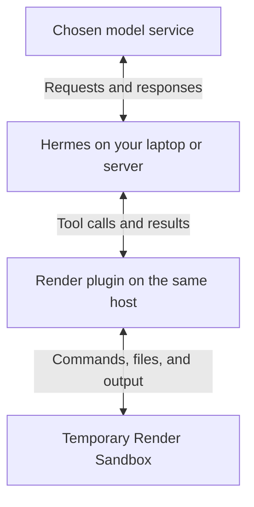

<div align="center">

# Hermes + Render Sandboxes

**Run Hermes commands, file edits, and Python in a temporary cloud environment.**

<p>
  <a href="#preview-status"></a>
  <a href="VALIDATION.md"></a>
  <a href="VALIDATION.md"></a>
  <a href="VALIDATION.md"></a>
</p>

[Quick start](#install-from-github) · [Examples](#tested-examples) · [How it works](#how-it-works) · [Validation](VALIDATION.md) · [Development](#development)

</div>

Give [Hermes Agent](https://github.com/NousResearch/hermes-agent) a temporary computer for code repair, data analysis, and file processing. Hermes stays on your laptop or server; its command, file, and Python tools work inside a [Render Sandbox](https://render.com/docs/sandboxes).

This is a **terminal-environment provider plugin**: it connects Hermes's existing tools to Render through `terminal.backend: render`. A skill supplies instructions for an agent; this plugin changes where its supported tools execute.

## Prerequisites

- **Hermes installed with a working model connection.** This preview was tested against [Hermes revision `dce1e9b`](https://github.com/NousResearch/hermes-agent/tree/dce1e9b37581dd62e480a9064dc04a709c2940d3), with host Python 3.14.3 on macOS. Compatibility with other revisions and host operating systems is unverified.
- **A Render workspace with [Sandboxes access](https://render.com/docs/sandboxes)** and a paid compute plan. The configuration below uses `starter`; sandbox tasks incur Render usage.
- **Your Render key and workspace ID**, described below. Keep your existing Hermes model credentials.

| Value | What it is for | Where to put it |
| --- | --- | --- |
| `RENDER_API_KEY` | Lets the plugin create and manage sandboxes. Create an API key in [Render account settings](https://dashboard.render.com/u/settings) with access to the selected workspace. | Enter it at the installer's hidden-input prompt. Hermes stores it in the active profile's `.env` file. |
| `workspace_id` | Identifies the workspace that owns and pays for the sandbox. Use its `tea-...` ID from Render; this value is not a secret. | Replace the placeholder in `config.yaml` below. |
| Model credentials | Let Hermes connect to your chosen model service, separately from Render. | Keep your normal Hermes model configuration on the host. |

## Install from GitHub

### 1. Install and enable the plugin

Run this in a terminal on the laptop or server where your `hermes` command already works:

```sh
hermes plugins install ojusave/hermes-plugin-render
```

Hermes identifies this repository as a custom source outside its reviewed catalog. If the Render key is missing, enter it at the prompt; the characters are masked. Answer `y` to enable `render`, then `y` to prepare its Python dependencies, the packages it needs to run. Hermes downloads them through its own package manager.

The verified installation reported:

```text
Plugin render enabled
```

If you decline dependency preparation, the plugin stays installed but disabled. See the [installation acceptance record](VALIDATION.md#github-installation-acceptance) for both paths.

### 2. Select Render for execution

Merge the settings below into the active Hermes profile's `config.yaml`. For the default profile on macOS, this is normally `~/.hermes/config.yaml`. If you use a named profile or a custom `HERMES_HOME`, edit that profile's file instead. Preserve existing settings and other enabled plugins.

Replace `tea-REPLACE_WITH_YOUR_WORKSPACE` with your Render workspace ID. The same example is available in [config.example.yaml](config.example.yaml).

```yaml
plugins:
  enabled:
    - render
  entries:
    render:
      enabled: true
      settings:
        workspace_id: tea-REPLACE_WITH_YOUR_WORKSPACE
        plan: starter
        lifetime_seconds: 900
        network_policy: deny-all
terminal:
  backend: render
  cwd: /workspace
  container_persistent: false
  timeout: 60
```

These settings start paid `starter` sandboxes with a 15-minute maximum lifetime and a 60-second command timeout. Outbound networking is blocked by default. The working directory, `/workspace`, is inside the sandbox.

> [!IMPORTANT]
> Keep `container_persistent: false` for this preview. Files survive commands within one environment, but Hermes cleans up that environment when the agent turn ends. Download any wanted files before then. The plugin does not automatically upload your local project or save generated project files to your computer.

### 3. Restart and check installation

Restart Hermes, then run this in the same host terminal and profile:

```sh
hermes plugins list --user
```

Check that `render` appears as enabled. With `terminal.backend: render` selected, Hermes routes its supported command, file, and Python tools to Render. Enabling the plugin alone does not change the execution location.

For a reproducible task with independently checked output, use the [example runner](#run-the-checks) after preparing the development checkout below.

## Tested examples

Four different tasks have run through real Hermes tools in real Render Sandboxes. Each result was downloaded and checked in a **second, fresh sandbox** using original inputs and protected checks.

| Task | Independently verified result | Evidence |
| --- | --- | --- |
| Repair a Python function | All five original tests passed; the broken version had failed three. | [Function-repair report](validation/public/live-agent.json) |
| Analyze a sales CSV | Five paid orders, totaling 5,755 cents. Checks covered duplicates, Unicode, and new and empty inputs. | [CSV report](validation/public/live-scenarios.json) |
| Fix a multi-file inventory program | Five original tests and three additional checks passed after repairing two source files. | [Inventory report](validation/public/live-scenarios.json) |
| Import and report with SQLite | Five unique events, totaling 1,450 cents. Repeated imports created no duplicates; an extra event raised the total to 1,475 cents. | [Database report](validation/public/live-scenarios.json) |

The CSV task also passed through a fresh [GitHub-installed copy of the plugin](VALIDATION.md#github-installation-acceptance). Every sandbox from these recorded runs was confirmed terminated. The [validation record](VALIDATION.md) includes tested versions, failure discoveries, cleanup checks, and remaining gaps.

## How it works

Your request reaches Hermes on the host, which can be your laptop or a server. Hermes talks to your chosen model service. When the model requests a supported tool, the plugin creates or uses a Render Sandbox and returns its output to Hermes. After the turn, Hermes asks the plugin to terminate the sandbox and verify cleanup.



The Render key stays on the host and is not injected into the sandbox environment. The plugin uses Hermes's supported provider interface, keeps its existing approval and protected-file rules, and leaves Hermes core unchanged. It does not silently fall back to local execution if Render fails.

The runtime plugin reads the active profile's Render secret. It never reads Render CLI or Codex login stores. The development test scripts can reuse those logins only through explicit flags.

## Preview status

This is a personal development preview under `ojusave`, outside the reviewed Hermes catalog. Recorded checks used Render's Python package, also called its software development kit (SDK), version **1.2.0**. The badges summarize those recorded checks; they are not a continuously running test service.

The local behavior suite recorded **23 passed, 1 skipped**. The skipped process-group test needs Linux; equivalent timeout and child-process behavior passed in a live Render Linux sandbox. The GitHub installer, its credential and dependency prompts, and the installed plugin's real execution path were also tested. A fresh normal CLI profile synchronized all 328 bundled skill files and completed two chat turns. [Read the full validation record.](VALIDATION.md)

**Reliability evidence:** 10 repeated sessions, three simultaneous profiles in one workspace, host termination, remote termination, rejected cleanup, and a real connection drop passed. [Results, failure discoveries and exact scope](VALIDATION.md#bounded-reliability-and-real-failures).

**The main limit is temporary work:** there is no automatic project export, cross-turn persistence, or snapshot/restore. Production load, gateway account isolation, resuming interrupted tasks, additional host operating systems, and interactive command-approval dialogs remain unverified. Organization ownership, licensing, catalog inclusion, and partner approval remain open.

<details>
<summary>All preview limits</summary>

- **Disposable turns:** `terminal.container_persistent` must be `false`. Files and shell state survive commands within the environment. At the pinned Hermes revision, a completed nonpersistent agent turn triggers cleanup. Download wanted project outputs before the turn ends. There is no automatic project-folder upload, patch export, or cross-turn snapshot/restore feature.
- Hermes's supported skill/cache synchronization is separate from project artifact export. Hermes maps supported state files back to their host locations, including new files under already-mapped directories. Explicit credential files remain upload-only. It is not a backup of `/workspace`.
- The initial Render filesystem image is used. Custom images, resource overrides beyond `starter`/`standard`/`pro`, preview URLs, interactive terminals and long-lived background services have not been validated.
- Cancellation covers ordinary child processes. A program that deliberately detaches into another process group is ultimately stopped by sandbox termination or expiry. No broader containment audit is claimed.
- A command plus standard input is limited to approximately 750 KB before encoding. Large input should be uploaded as a file. UTF-8 output is supported; terminal output is not a binary file-transfer channel.
- A lost creation response may leave an unobserved sandbox until its lifetime expires. The plugin does not retry creation automatically. Inspect the Render Dashboard before retrying an ambiguous task. Sandbox IDs are logged when known.
- Three concurrent profiles in one workspace passed; gateway concurrency across accounts, sustained load and additional host operating systems need review before a general release. Host-crash containment passed, but interrupted tasks cannot automatically resume. The runtime tests use Hermes's existing approval behavior. Installer consent prompts were tested; interactive command-approval dialogs were not.

</details>

## Development

A source checkout is needed only to change the plugin or run its acceptance scripts. Normal users can use the GitHub installation above.

<details>
<summary>Set up the development checkout</summary>

Install Git and Python 3.14, then open a terminal in your development folder. Clone the plugin into `hermes-render` so the paths below match:

```sh
git clone https://github.com/ojusave/hermes-plugin-render.git hermes-render
git clone --filter=blob:none https://github.com/NousResearch/hermes-agent.git hermes-agent-reference
git -C hermes-agent-reference checkout dce1e9b37581dd62e480a9064dc04a709c2940d3
cd hermes-agent-reference
HERMES_HOME=../hermes-render/.test-home \
HERMES_RUNTIME_DIR=../hermes-render/.runtime \
python3 -m pm.build_env \
  --source ../hermes-render/dev \
  --out ../hermes-render/.venv \
  --python python3 --resolve
cd ../hermes-render
```

Hermes's package manager creates `.venv` from the separate `dev/` project. That project includes the adjacent Hermes checkout as an editable development dependency. The installed plugin declares only `render>=1.2.0,<1.3`, so its normal installation does not depend on the maintainer's local checkout layout.

The test scripts install a copy of the plugin into separate profiles under `.test-home/`. They do not change your normal Hermes configuration. The acceptance commands below use an existing Render CLI login only when you explicitly pass `--render-cli-auth`.

</details>

### Run the checks

<details>
<summary>Local tests and live Render examples</summary>

Complete the development setup above first. Live commands create paid Render resources; their runners terminate them and record cleanup results.

From that project directory, run:

```sh
.venv/bin/python -m pytest -q tests
.venv/bin/python scripts/live_smoke.py --render-cli-auth
.venv/bin/python scripts/live_runtime.py --render-cli-auth
.venv/bin/python scripts/live_features.py --render-cli-auth
```

The first command runs local behavior tests. The others create paid, short-lived sandboxes using the existing Render CLI login, exercise the real Hermes loader and tools, and terminate their sandboxes. Each writes a git-ignored JSON report under `validation/`. Sanitized evidence from the recorded acceptance run is in `validation/public/`. Successful reports contain completed checks and verified cleanup, with variable IDs and timings.

For the actual model-driven task, run:

```sh
.venv/bin/python scripts/live_agent.py --render-cli-auth --codex-login
```

This uses the existing Codex access token without refreshing or writing that login. It gives Hermes a synthetic broken function and five tests. A tool-completion callback downloads the changed file before Hermes's ordinary end-of-turn cleanup. A second clean sandbox then runs the unchanged original tests against that downloaded file. See [the actual result](validation/public/live-agent.json) and [the verified function](validation/agent-artifacts/verified_totals.py).

To test three different model-driven tasks, run:

```sh
.venv/bin/python scripts/live_scenarios.py --render-cli-auth --codex-login
```

This asks Hermes to analyze a sales CSV, repair a multi-file command-line program, and build a SQLite import-and-report workflow. Each task runs in its own Render Sandbox. Its downloaded files are checked in a second fresh sandbox against original inputs and additional checks that Hermes cannot edit. The database check repeats the import and adds a new event; the CSV check also uses new and empty inputs. Six sandboxes are created and terminated for a complete run.

The runner saves raw reports and downloaded files under the git-ignored `validation/private/scenarios/` directory, plus a sanitized [multi-task report](validation/public/live-scenarios.json). To repeat just one task, add `--case csv_analysis`, `--case multifile_repair`, or `--case sqlite_workflow`.

For the smoke, runtime, feature and model-scenario scripts above, to use environment-based Render authentication instead of the CLI test flag, supply `RENDER_API_KEY` and `RENDER_WORKSPACE_ID` to the test process and omit `--render-cli-auth`. `RENDER_WORKSPACE_ID` is a test-helper input; normal plugin configuration uses the YAML setting above.

</details>

<details>
<summary>Reliability and ordinary CLI acceptance</summary>

After the development setup above, run these commands in `hermes-render` to exercise repeated sessions, three simultaneous profiles, forced failures and a real connection interruption:

```sh
.venv/bin/python scripts/live_reliability.py --render-cli-auth
.venv/bin/python scripts/live_transport.py --render-cli-auth
```

These commands create paid starter sandboxes, check real results, and verify termination. They require the existing Render CLI login. The reliability check takes about five minutes and uses 16 sandboxes; the connection check uses one. The connection test forwards encrypted traffic through a listener on this computer only, closes the test connection, then restores that process's networking settings. It does not change system-wide networking.

The ordinary GitHub-install test also needs a separate Hermes environment without Render installed. From this same development directory, prepare it once with Hermes's package manager. If `.test-home/installer/base-venv` already exists from an earlier check, skip preparation and run the last command:

```sh
HERMES_HOME="$PWD/.test-home/installer" \
HERMES_RUNTIME_DIR="$PWD/.runtime/installer" \
.venv/bin/python -m pm.build_env \
  --source ../hermes-agent-reference \
  --out .test-home/installer/base-venv \
  --python "$PWD/.venv/bin/python"
.venv/bin/python scripts/live_onboarding.py --render-cli-auth --codex-login
```

This test requires a valid existing Codex model login as well as Render access. It installs from GitHub, accepts the installer prompts, applies the sample configuration, and runs two normal CLI chat commands. The first computes 66, verifies Linux and checks the full skill library. The second resumes the conversation and confirms that the prior turn's temporary project file is gone. The pinned Hermes version also creates and cleans up one operating-system probe, making three sandboxes in total. The test removes its temporary credential files; it does not rotate the original model login.

Each runner prints a passing or failed result and writes a sanitized report under `validation/public/`. Raw transcripts and exact resource identifiers stay git-ignored under `validation/private/`. A passing result requires output checks and cleanup, not just the model's final answer. These automated checks do not replace a separate developer trying the guide.

</details>

<details>
<summary>Package the plugin or install a local build</summary>

Run `.venv/bin/python scripts/package_plugin.py` from the project directory. It creates `dist/render/` and `dist/hermes-render-0.1.0a1.tar.gz` using only the runtime plugin and its instructions, then runs Hermes's official validator against that exact payload. Private test profiles, dependencies, credentials and raw local reports are excluded. Sanitized acceptance evidence and synthetic fixtures are included. The script also validates a separate clean copy of all authored development source, including tests and scripts.

Hermes's [manual plugin discovery](https://hermes-agent.nousresearch.com/docs/developer-guide/plugins) loads a plugin directory under the selected profile's `plugins/` directory. For a manual preview install, copy the **contents** of `dist/render/` into `<profile-home>/plugins/render/`, use Hermes's package manager to prepare the declared dependency, and merge [config.example.yaml](config.example.yaml) into that profile's `config.yaml`. Do not replace unrelated settings. Add `RENDER_API_KEY` to that profile's `.env` and restart Hermes. The live scripts test this discovery path with an isolated profile and an already-prepared dependency environment.

The normal GitHub installer and its dependency-consent flow have been tested in fresh profiles, including a subsequent task through the installed plugin. The manual path above remains useful for local development. Catalog inclusion still requires maintainer review.

</details>

<details>
<summary>Implementation principles</summary>

1. **Use the supported extension.** Register through `register_terminal_environment_provider`; leave Hermes and Render SDK code unchanged. Preserve Hermes's command, file and Python tools instead of introducing competing tools.
2. **Keep ownership explicit.** Each environment owns one sandbox, with a paid plan, explicit lifetime and outbound network policy. Default outbound traffic is denied. Set `allow-all` only for work that needs it, such as downloading packages.
3. **Separate credentials and execution.** Resolve the active profile's Render secret on the host. Preserve Hermes's approval checks and its protected-file rules. Only its supported skill/cache files and explicitly configured service files participate in normal synchronization.
4. **Report uncertainty honestly.** Preserve output and exit status. A broken execution stream is a connection failure, never exit code zero. Do not silently run commands locally or replay work after an ambiguous failure.
5. **Stop and clean up.** A remote supervisor stops a timed-out or interrupted command's ordinary process group. If cancellation cannot be delivered, terminate the sandbox. Cleanup is retryable and checks the resulting resource state.
6. **Prove results independently.** Test the actual installed plugin and real tools. For the model task, verify the downloaded output with the original tests in a separate sandbox. Record failures and limits, not just the agent's success message.

</details>

## References and feedback

- [Hermes provider contract](https://hermes-agent.nousresearch.com/docs/developer-guide/terminal-environment-plugin): the extension interface used by this plugin.
- [Render Python SDK](https://render.com/docs/sandboxes-sdk-python): sandbox creation, execution, file transfer, and cleanup.
- [Hermes catalog submission](https://hermes-agent.nousresearch.com/docs/developer-guide/plugins/catalog-submission): the separate review process for catalog inclusion.
- [Report an issue](https://github.com/ojusave/hermes-plugin-render/issues): include your Hermes revision, host Python version, and a minimal example. Remove credentials and private data from logs before sharing them.
