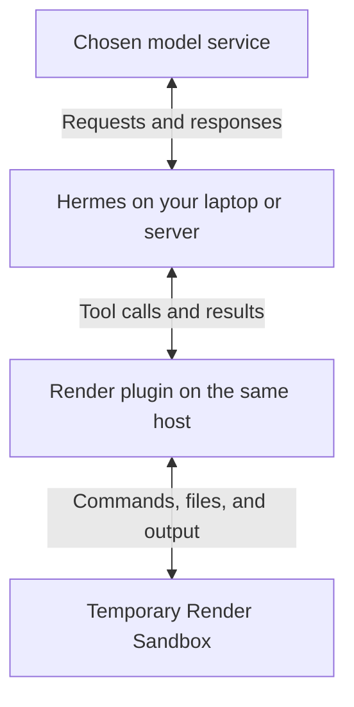

<div align="center">

# Hermes + Render Sandboxes

**Run AI-generated code with Hermes on a temporary cloud computer.**

<p>
  <a href="#preview-status"></a>
  <a href="#prerequisites"></a>
  <a href="https://render.com/docs/sandboxes-sdk-python"></a>
</p>

[Quick start](#install-from-github) · [Examples](#examples) · [How it works](#how-it-works)

</div>

[Hermes Agent](https://github.com/NousResearch/hermes-agent) is an AI assistant that can run commands and edit files. When you ask it to analyze data or test a code fix, those commands need somewhere to run. A **sandbox** gives them a separate workspace from the computer running your assistant.

This plugin uses [Render Sandboxes](https://render.com/docs/sandboxes), temporary Linux computers in the cloud, for that workspace. Hermes stays on your laptop or server and talks to your chosen model service; its command, file, and Python tools execute on Render. Start with the [small calculation below](#examples), then use the same connection for code repair, data analysis, or file processing.

## Prerequisites

- **Hermes installed with a working model connection.** This preview was tested against [Hermes revision `dce1e9b`](https://github.com/NousResearch/hermes-agent/tree/dce1e9b37581dd62e480a9064dc04a709c2940d3), with host Python 3.14.3 on macOS. Compatibility with other revisions and host operating systems is unverified.
- **A Render workspace with [Sandboxes access](https://render.com/docs/sandboxes)** and a paid compute plan. The configuration below uses `starter`; sandbox tasks incur Render usage.
- **Your Render key and workspace ID**, described below. Keep your existing Hermes model credentials.

| Value | What it is for | Where to put it |
| --- | --- | --- |
| `RENDER_API_KEY` | Lets the plugin create and manage sandboxes. Create an API key in [Render account settings](https://dashboard.render.com/u/settings) with access to the selected workspace. | Enter it at the installer's hidden-input prompt. Hermes stores it in the active profile's `.env` file. |
| `workspace_id` | Identifies the workspace that owns and pays for the sandbox. Use its `tea-...` ID from Render; this value is not a secret. | Replace the placeholder in `config.yaml` below. |
| Model credentials | Let Hermes connect to your chosen model service, separately from Render. | Keep your normal Hermes model configuration on the host. |

## Install from GitHub

### 1. Install and enable the plugin

Run this in a terminal on the laptop or server where your `hermes` command already works:

```sh
hermes plugins install ojusave/hermes-plugin-render
```

Hermes identifies this repository as a custom source outside its reviewed catalog. If the Render key is missing, enter it at the prompt; the characters are masked. Answer `y` to enable `render`, then `y` to prepare its Python dependencies, the packages it needs to run. Hermes downloads them through its own package manager.

When installation finishes, Hermes prints:

```text
Plugin render enabled
```

If you decline dependency preparation, the plugin stays installed but disabled.

### 2. Select Render for execution

Merge the settings below into the active Hermes profile's `config.yaml`. For the default profile on macOS, this is normally `~/.hermes/config.yaml`. If you use a named profile or a custom `HERMES_HOME`, edit that profile's file instead. Preserve existing settings and other enabled plugins.

Replace `tea-REPLACE_WITH_YOUR_WORKSPACE` with your Render workspace ID. The same example is available in [config.example.yaml](config.example.yaml).

```yaml
plugins:
  enabled:
    - render
  entries:
    render:
      enabled: true
      settings:
        workspace_id: tea-REPLACE_WITH_YOUR_WORKSPACE
        plan: starter
        lifetime_seconds: 900
        network_policy: deny-all
terminal:
  backend: render
  cwd: /workspace
  container_persistent: false
  timeout: 60
```

These settings start paid `starter` sandboxes with a 15-minute maximum lifetime and a 60-second command timeout. Outbound networking is blocked by default. The working directory, `/workspace`, is inside the sandbox.

> [!IMPORTANT]
> Keep `container_persistent: false` for this preview. Files survive commands within one environment, but Hermes cleans up that environment when the agent turn ends. Download any wanted files before then. The plugin does not automatically upload your local project or save generated project files to your computer.

### 3. Restart and check installation

Restart Hermes, then run this in the same host terminal and profile:

```sh
hermes plugins list --user
```

Check that `render` appears as enabled. With `terminal.backend: render` selected, Hermes routes its supported command, file, and Python tools to Render. Enabling the plugin alone does not change the execution location.

## Examples

After selecting Render as the backend, open a Hermes chat and try a calculation that needs no input files or extra packages:

> Use Python in `/workspace` to add 12, 24, and 30. Save a JSON object with the computed sum in a `total` field to `report.json`. Read the file back and show me its contents before finishing.

Check the command and file-reading results in the chat. The report should contain:

```json
{"total": 66}
```

Copy the displayed result if you want to keep it. This preview removes the sandbox when the agent finishes its turn, so a later message does not retain that file.

For a larger task, supply the required inputs and ask Hermes to:

- Fix a Python function and run its tests.
- Total the paid orders in a CSV file, ignoring duplicates and cancelled orders.
- Read JSON records into a SQLite database and generate a summary.

Give Hermes the input files it needs and ask it to return the output before the turn ends. The plugin does not automatically copy your local project into the sandbox or save generated files back to your computer.

## How it works

Your request reaches Hermes on the host, which can be your laptop or a server. Hermes talks to your chosen model service. When the model requests a supported tool, the plugin creates or uses a Render Sandbox and returns its output to Hermes. After the turn, Hermes asks the plugin to terminate the sandbox and verify cleanup.

The plugin connects Hermes's existing tools to Render through `terminal.backend: render`. Hermes calls this a **terminal-environment provider plugin**. A skill supplies instructions for an agent; this plugin changes where its supported tools execute.



The Render key stays on the host and is not injected into the sandbox environment. The plugin uses Hermes's supported provider interface, keeps its existing approval and protected-file rules, and leaves Hermes core unchanged. It does not silently fall back to local execution if Render fails.

The plugin reads the Render key from your active Hermes profile.

## Preview status

This community preview is installed from GitHub and is outside the reviewed Hermes catalog. It supports temporary work within one agent turn. It does not provide automatic project export, cross-turn persistence, or snapshot restore.

Keep `container_persistent: false` and save wanted files before the turn ends. Hermes's skill and cache synchronization is separate from your project files; it does not back up `/workspace`.

Commands use the initial Render filesystem image. The plugin does not provide public preview URLs or interactive terminals. A command plus its standard input is limited to about 750 KB; upload larger inputs as files.

If sandbox creation loses its response, check the Render Dashboard before trying again. The plugin does not automatically retry creation. Known sandbox IDs appear in the logs, and each sandbox also has a maximum lifetime.

## References and feedback

- [Hermes provider contract](https://hermes-agent.nousresearch.com/docs/developer-guide/terminal-environment-plugin): the extension interface used by this plugin.
- [Render Python SDK](https://render.com/docs/sandboxes-sdk-python): sandbox creation, execution, file transfer, and cleanup.
- [Report an issue](https://github.com/ojusave/hermes-plugin-render/issues): include your Hermes revision, host Python version, and a minimal example. Remove credentials and private data from logs before sharing them.
