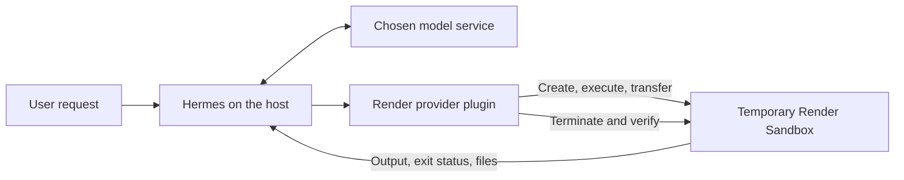

# Run Hermes tools in Render Sandboxes

This development preview lets Hermes run commands, edit files and execute Python in a temporary Render Sandbox. Hermes and its model connection stay on the original computer. The sandbox supplies the computer where the requested code runs.

Hermes calls this connection a **terminal-environment provider plugin**. Selecting `terminal.backend: render` routes its existing tools through the plugin. A skill is a set of instructions an agent follows; it does not by itself change where those tools run.



The code-repair task in the tests demonstrates the connection. Other command, file and Python tasks use the same provider.

## Prerequisites

This is a development preview published under the maintainer's personal account. It is not listed in the Hermes catalog. Tested against Hermes revision `dce1e9b37581dd62e480a9064dc04a709c2940d3`, Python **3.14.3**, and Render's Python package **1.2.0**. Compatibility with other Hermes revisions is not established. Hermes's source is unchanged.

You need an installed Hermes environment with that provider interface, an enabled [Render Sandboxes workspace](https://render.com/docs/sandboxes), a paid compute plan, and a configured model connection. The default plan here is `starter`; live tests incur Render usage.

| Value | Purpose and location |
| --- | --- |
| `RENDER_API_KEY` | Authorizes the host plugin to create and manage sandboxes. Create it in [Render account settings](https://dashboard.render.com/u/settings), with access to the selected workspace. Store it in the active Hermes profile's `.env`, following Hermes's normal secret setup. |
| `plugins.entries.render.settings.workspace_id` | Selects the workspace that owns and pays for the sandbox. Use its `tea-...` ID from Render. This is not a secret. |
| Model credentials | Used by Hermes on the host, separately from Render authentication. Keep your normal Hermes model configuration. |

The runtime plugin never reads the Render CLI or Codex login stores. Local acceptance scripts can explicitly opt into read-only reuse of those existing logins. No account key is sent as part of the sandbox environment.

## Set up the development checkout

Install Git and Python 3.14, then open a terminal in your development folder. Clone the plugin into `hermes-render` so the paths below match:

```sh
git clone https://github.com/ojusave/hermes-plugin-render.git hermes-render
git clone --filter=blob:none https://github.com/NousResearch/hermes-agent.git hermes-agent-reference
git -C hermes-agent-reference checkout dce1e9b37581dd62e480a9064dc04a709c2940d3
cd hermes-agent-reference
HERMES_HOME=../hermes-render/.test-home \
HERMES_RUNTIME_DIR=../hermes-render/.runtime \
python3 -m pm.build_env \
  --source ../hermes-render \
  --out ../hermes-render/.venv \
  --python python3 --group dev --resolve
cd ../hermes-render
```

Hermes's package manager creates the plugin's `.venv` with the declared dependencies. The adjacent Hermes checkout is an editable development dependency, required by Hermes's source-install policy. The plugin's production dependency is `render>=1.2.0,<1.3`.

The test scripts install a copy of the plugin into separate profiles under `.test-home/`. They do not change your normal Hermes configuration. The acceptance commands below use an existing Render CLI login only when you explicitly pass `--render-cli-auth`.

## Run the checks

From that project directory, run:

```sh
.venv/bin/python -m pytest -q tests
.venv/bin/python scripts/live_smoke.py --render-cli-auth
.venv/bin/python scripts/live_runtime.py --render-cli-auth
.venv/bin/python scripts/live_features.py --render-cli-auth
```

The first command runs local behavior tests. The others create paid, short-lived sandboxes using the existing Render CLI login, exercise the real Hermes loader and tools, and terminate their sandboxes. Each writes a git-ignored JSON report under `validation/`. Sanitized evidence from the recorded acceptance run is in `validation/public/`. Successful reports contain completed checks and verified cleanup, with variable IDs and timings.

For the actual model-driven task, run:

```sh
.venv/bin/python scripts/live_agent.py --render-cli-auth --codex-login
```

This uses the existing Codex access token without refreshing or writing that login. It gives Hermes a synthetic broken function and five tests. A tool-completion callback downloads the changed file before Hermes's ordinary end-of-turn cleanup. A second clean sandbox then runs the unchanged original tests against that downloaded file. See [the actual result](validation/public/live-agent.json) and [the verified function](validation/agent-artifacts/verified_totals.py).

To test three different model-driven tasks, run:

```sh
.venv/bin/python scripts/live_scenarios.py --render-cli-auth --codex-login
```

This asks Hermes to analyze a sales CSV, repair a multi-file command-line program, and build a SQLite import-and-report workflow. Each task runs in its own Render Sandbox. Its downloaded files are checked in a second fresh sandbox against original inputs and additional checks that Hermes cannot edit. The database check repeats the import and adds a new event; the CSV check also uses new and empty inputs. Six sandboxes are created and terminated for a complete run.

The runner saves raw reports and downloaded files under the git-ignored `validation/private/scenarios/` directory, plus a sanitized [multi-task report](validation/public/live-scenarios.json). To repeat just one task, add `--case csv_analysis`, `--case multifile_repair`, or `--case sqlite_workflow`.

To use environment-based Render authentication instead of the CLI test flag, supply `RENDER_API_KEY` and `RENDER_WORKSPACE_ID` to the test process and omit `--render-cli-auth`. `RENDER_WORKSPACE_ID` is a test-helper input; normal plugin configuration uses the YAML setting above.

## Package and configuration

Run `.venv/bin/python scripts/package_plugin.py` from the project directory. It creates `dist/render/` and `dist/hermes-render-0.1.0a1.tar.gz` using only the runtime plugin and its instructions, then runs Hermes's official validator against that exact payload. Private test profiles, dependencies, credentials and raw local reports are excluded. Sanitized acceptance evidence and synthetic fixtures are included. The script also validates a separate clean copy of all authored development source, including tests and scripts.

Hermes's [manual plugin discovery](https://hermes-agent.nousresearch.com/docs/developer-guide/plugins) loads a plugin directory under the selected profile's `plugins/` directory. For a manual preview install, copy the **contents** of `dist/render/` into `<profile-home>/plugins/render/`, use Hermes's package manager to prepare the declared dependency, and merge [config.example.yaml](config.example.yaml) into that profile's `config.yaml`. Do not replace unrelated settings. Add `RENDER_API_KEY` to that profile's `.env` and restart Hermes. The live scripts test this discovery path with an isolated profile and an already-prepared dependency environment.

The repository is available for review and development. The normal interactive Git-based installer and dependency-consent flow have not been tested, so the preview instructions use the validated manual discovery path. A passing local validator is not catalog approval.

## Principles followed

1. **Use the supported extension.** Register through `register_terminal_environment_provider`; leave Hermes and Render SDK code unchanged. Preserve Hermes's command, file and Python tools instead of introducing competing tools.
2. **Keep ownership explicit.** Each environment owns one sandbox, with a paid plan, explicit lifetime and outbound network policy. Default outbound traffic is denied. Set `allow-all` only for work that needs it, such as downloading packages.
3. **Separate credentials and execution.** Resolve the active profile's Render secret on the host. Preserve Hermes's approval checks and its protected-file rules. Only its supported skill/cache files and explicitly configured service files participate in normal synchronization.
4. **Report uncertainty honestly.** Preserve output and exit status. A broken execution stream is a connection failure, never exit code zero. Do not silently run commands locally or replay work after an ambiguous failure.
5. **Stop and clean up.** A remote supervisor stops a timed-out or interrupted command's ordinary process group. If cancellation cannot be delivered, terminate the sandbox. Cleanup is retryable and checks the resulting resource state.
6. **Prove results independently.** Test the actual installed plugin and real tools. For the model task, verify the downloaded output with the original tests in a separate sandbox. Record failures and limits, not just the agent's success message.

## Limits of this preview

- **Disposable turns:** `terminal.container_persistent` must be `false`. Files and shell state survive commands within the environment. At the pinned Hermes revision, a completed nonpersistent agent turn triggers cleanup. Download wanted project outputs before the turn ends. There is no automatic project-folder upload, patch export, or cross-turn snapshot/restore feature.
- Hermes's supported skill/cache synchronization is separate from project artifact export. Only pre-existing mapped files synchronize back. It is not a backup of `/workspace`.
- The initial Render filesystem image is used. Custom images, resource overrides beyond `starter`/`standard`/`pro`, preview URLs, interactive terminals and long-lived background services have not been validated.
- Cancellation covers ordinary child processes. A program that deliberately detaches into another process group is ultimately stopped by sandbox termination or expiry. No broader containment audit is claimed.
- A command plus standard input is limited to approximately 750 KB before encoding. Large input should be uploaded as a file. UTF-8 output is supported; terminal output is not a binary file-transfer channel.
- A lost creation response may leave an unobserved sandbox until its lifetime expires. The plugin does not retry creation automatically. Inspect the Render Dashboard before retrying an ambiguous task. Sandbox IDs are logged when known.
- Gateway concurrency, account switching, sustained load, crash recovery and additional operating systems need review before a general release. A local non-interactive Hermes test uses Hermes's existing approval behavior; interactive approval dialogs were not tested.

See [VALIDATION.md](VALIDATION.md) for results, failure discoveries and remaining release work. Official references: [Hermes provider contract](https://hermes-agent.nousresearch.com/docs/developer-guide/terminal-environment-plugin), [Render Python SDK](https://render.com/docs/sandboxes-sdk-python), and [Hermes catalog submission](https://hermes-agent.nousresearch.com/docs/developer-guide/plugins/catalog-submission).
